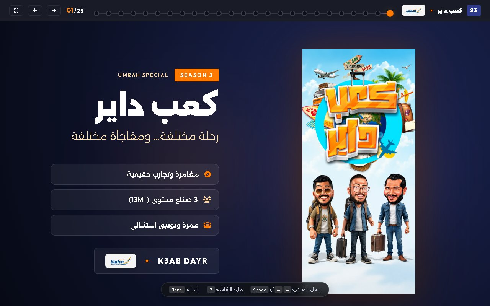

# CAPDARE — Travel Content Production & Collaboration Proposal



🌐 **Live Production Deployment:** [k3abdayr-presentation.vercel.app](https://k3abdayr-presentation.vercel.app)  
👨‍💻 **Engineering & Execution:** [Mostafa Mohamed Farhat (Elshorbagy)](https://mostafa-portfolio-iota.vercel.app/) — *Interactive B2B Travel Content Production Presentation (ProMedia)*

---

### ملف إنتاج محتوى السفر والشراكة السياحية الاستراتيجية (B2B)

العرض التقديمي التفاعلي ثنائي اللغة (EN / AR) لخدمات إنتاج وتوثيق محتوى السفر والشراكة مع شركات السياحة ومنظمي الرحلات.

> **"Every Journey Has a Story Worth Sharing."**
> **«لكل رحلة قصة تستحق أن تُروى.»**

---

## 🌟 نظرة عامة | Overview
- **هيكل العرض:** 20 شريحة تفاعلية متناسقة ومصممة خصيصاً لاجتماعات الأعمال مع شركات السياحة.
- **نظام ثنائي اللغة:** إنجليزية (الافتراضية) / عربية مع محول لغات فوري بدون إعادة تحميل الصفحة وبحفظ موضع الشريحة النشطة.
- **نموذج الإنتاج:** 5 حلقات رئيسية متكاملة لكل رحلة (1 قبل السفر • 3 في الوجهة • 1 رحلة العودة) + ستوريز يومية حية 24/7.
- **فريق الإنتاج:** 3 أعضاء أساسيين من كعب داير (مازن ومعاذ + المخرج محمد الهجان) + حتى 2 مرشدين مرافقين (إجمالي المجموعة 5 أشخاص كحد أقصى).
- **الاتفاق المالي:** اتفاق مرن ومفتوح للتفاوض المشترك بحسب مدة الرحلة، الوجهة، وحجم الإنتاج.

---

## 💻 طريقة التشغيل | How to Run
يمكن فتح العرض مباشرة بفتح ملف `index.html` في المتصفح، أو تشغيل السيرفر المدمج:
```bash
node server.js
```
ثم فتح الرابط في المتصفح:
👉 `http://localhost:8080/`
